# Replacing the Wi-Fi dongle with an ESP32-C3

This guide swaps MRCOOL's SmartHVAC Wi-Fi dongle for an ESP32-C3 running this firmware. The C3 ends up inside the original dongle's case and plugs into the same socket. Nothing outside the indoor unit changes.

It covers the single-cable setup (Option A in [wiring.md](wiring.md)). The photos are from an O-ES-09-HP-230E with a Seeed Studio XIAO ESP32-C3.

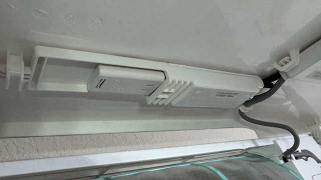

## What you need

| Item | Notes |
|---|---|
| [ESP32-C3 board with native USB-C](https://amzn.to/4hU1x7O) | The photos use a Seeed Studio XIAO ESP32-C3 with its stick-on antenna. Other boards that fit are listed in [wiring.md](wiring.md#2-parts). |
| [Short USB-C (male) to USB-A (male) adapter](https://amzn.to/4hZZlLY) | A compact one-piece adapter, not a cable. It has to fit inside the dongle's case. |
| Phillips screwdriver | For the screw that holds the USB board to the unit. |
| [Hobby knife with a flat chisel blade](https://amzn.to/4dGtLBI) | For trimming the socket. A pointed blade slips more easily. |
| Spudger or guitar pick | For opening the dongle's case. |
| Optional: a standard USB-A socket and a soldering iron | Instead of trimming the original socket. |

## Before you start

1. **Flash and pair the C3 at your desk.** Follow the [README](../README.md): `make flash`, Wi-Fi setup, then add it to the Home app. Once the C3 is in the AC, its USB socket is the AC link. You can't use it as a serial console there, so updates go over Wi-Fi with `make ota`.
2. **Turn the mini-split off at the breaker.** You'll be unplugging wires inside the indoor unit.

## 1. Remove the USB board from the indoor unit

Lift the indoor unit's front panel. The dongle sits in a white plastic enclosure on the underside of the lid, with a grey cable running to the main board.

1. Remove the screw that holds the enclosure to the lid.
2. Slide the enclosure out.
3. Open the plastic enclosure.
4. Unplug the set of wires that runs to the main board. Take a photo first so you can route them the same way later.
5. Lift the USB board out of the enclosure, and pull the Wi-Fi dongle out of its socket.

## 2. Open up the USB socket

The socket on the USB board looks like USB-A, but it isn't standard. It's keyed so that only MRCOOL's dongle fits. The dongle's plug has a stepped plastic insert. A standard USB-A plug has a flat tongue, and the socket's extra plastic blocks it.

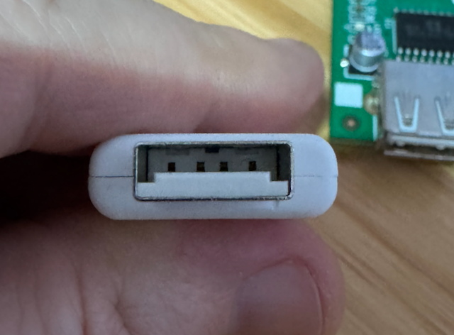

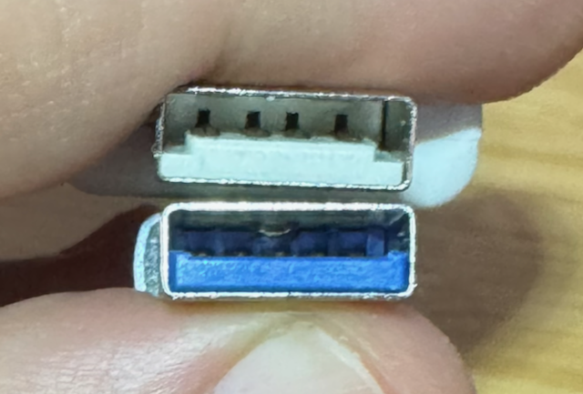

There are two ways to make the socket take a standard plug.

### Option 1: trim the socket

Use the chisel blade to shave off the extra plastic at the sides of the socket's tongue. Take thin slivers, keep the blade away from the metal contacts, and shake out the shavings as you go.

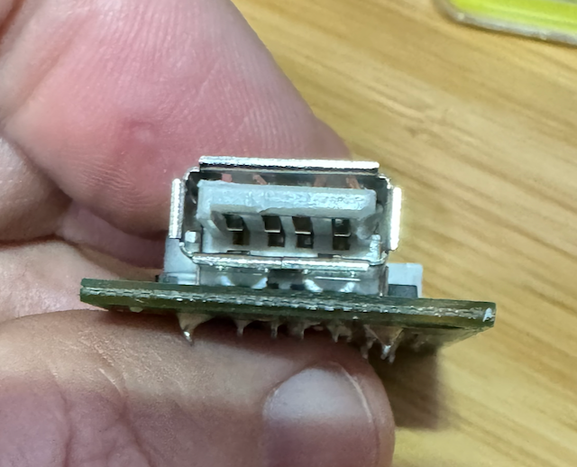

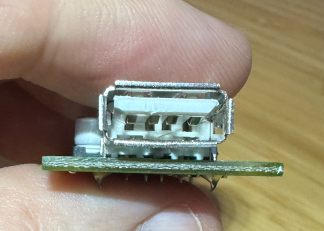

### Option 2: replace the socket

Desolder the keyed socket and solder a standard USB-A socket in its place.

### Check the fit

A standard USB-A plug should now go in fully, without force.

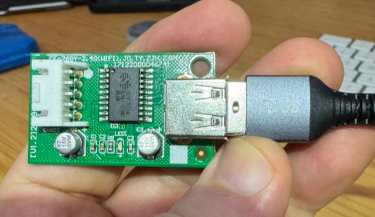

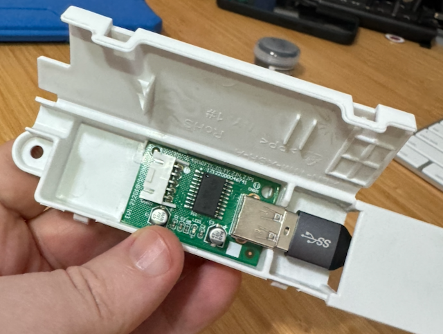

## 3. Measure the data lines

The C3 connects straight to the AC's data lines, and its pins can't take 5 V. A standard plug now fits, so a USB-A breakout or a cut cable makes this easy. Follow the steps in [wiring.md](wiring.md#1-measure-the-acs-data-lines). If either line reads about 5 V, stop here and use the wired setup with a level shifter (Option B in that guide) instead.

## 4. Build the new dongle

### Open the old dongle

The original dongle is an ESP-12F board in a two-part snap-together case. Twist the case slightly, or work a spudger or guitar pick into the seam, and it pops open. Take the ESP-12F board out. The empty case is reused.

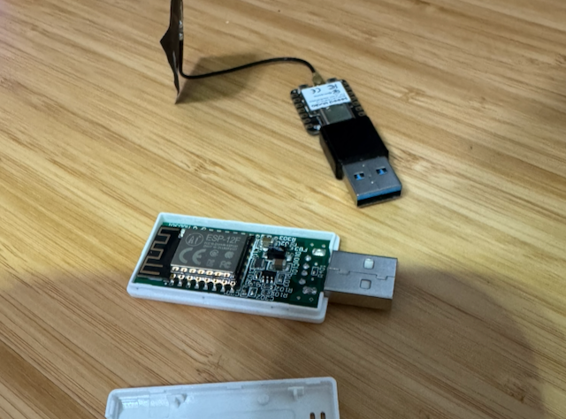

### Match the orientation

USB-C is reversible, so the adapter can go on the C3 either way up. Pick the way that makes the new dongle plug in the same way up as the old one. Lay the old board and the new one side by side, as in the photo, and check that the plugs match.

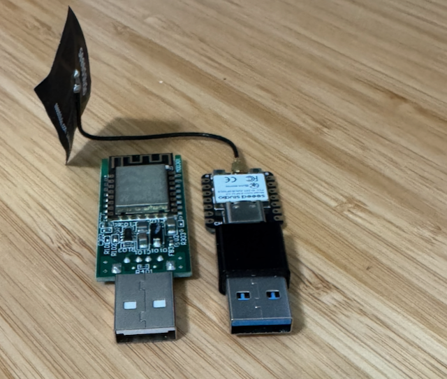

### Fit the C3 into the case

1. Plug the adapter into the C3's USB-C socket.
2. Seat the C3 in one half of the case, with the adapter sticking out where the old plug was.

   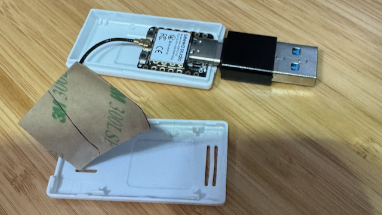

3. Fold the antenna over the top of the board. Keep the antenna wire away from the edges of the case: it catches in the snaps easily.

   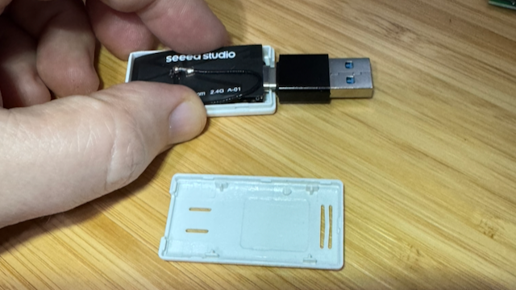

4. Snap the two halves together. If they won't close all the way, open the case and check the antenna wire.

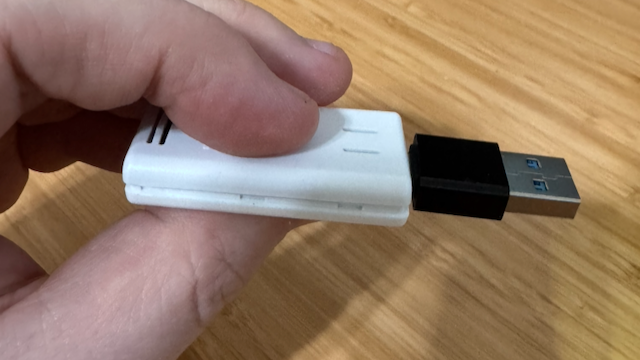

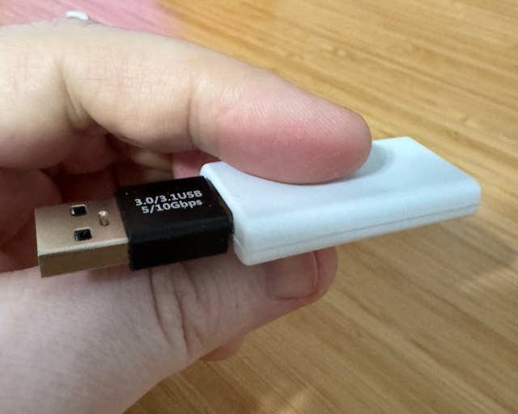

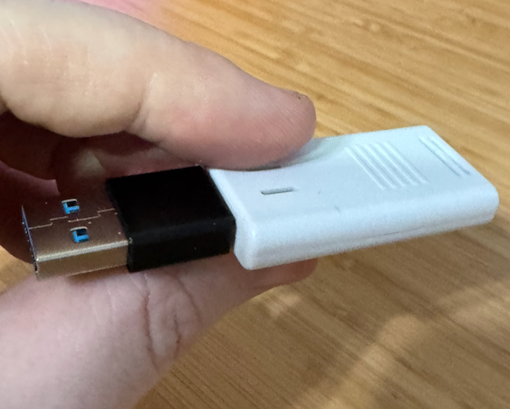

## 5. Put the unit back together

1. Put the USB board back in its enclosure.
2. Reconnect the wires to the main board, routed as they were.
3. Close the enclosure, slide it back into the indoor unit, and refit the screw.
4. Plug in the new dongle. Check that it sits in the enclosure the same way the original did.

## 6. Check that it works

1. Turn the breaker back on.
2. After about 30 seconds, open the web log at `http://<host>.local/log` (or the board's IP address). Look for:
   - `First status from the indoor unit: ...` — the C3 and the AC are talking. This is the one that matters.
   - `UART lines confirmed` and `Indoor unit is answering on the UART` also appear, but on their own they don't prove the link works.
3. Open the Home app. The tile should show the unit's real mode and set point. Change the set point, and the unit should beep and follow.

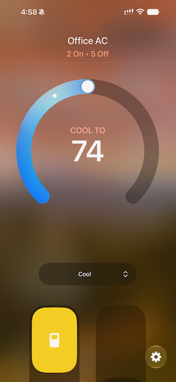

If the log shows `No status from the indoor unit` or `HomeKit change ignored`, see [Troubleshooting](../README.md#troubleshooting) in the README.
